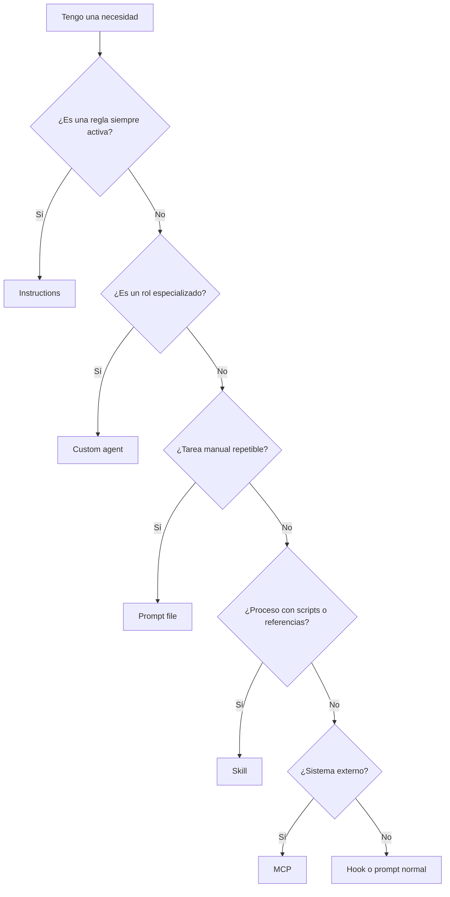
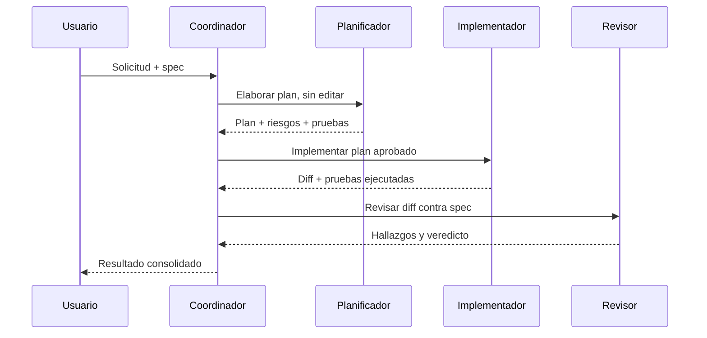
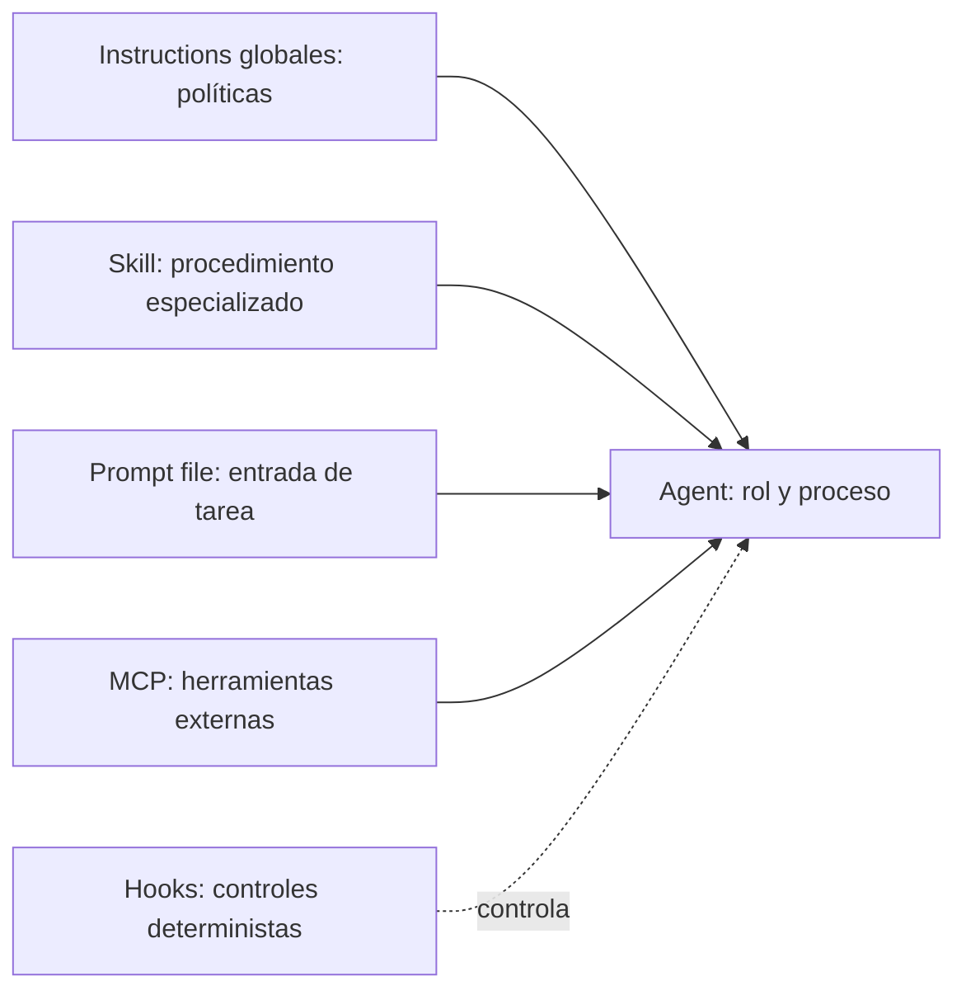

# Guía completa para crear agentes de GitHub Copilot

**VS Code e IntelliJ · Java 11 · Spring Boot · Angular · Oracle · Maven · SonarQube · Legacy**

Esta guía enseña a **diseñar, crear, probar, depurar y mantener agentes personalizados**, junto con instructions, skills, prompt files, hooks y harnesses. Incluye un kit de autoría con coordinador y workers, skills especializadas y un hook Copilot de ejemplo que permanece inactivo hasta que se copia voluntariamente a su ubicación de configuración.


## Fuentes oficiales y fecha de consulta

Consulta: **5 de noviembre de 2026**.

- [GitHub: Custom agents configuration](https://docs.github.com/copilot/reference/custom-agents-configuration)
- [GitHub: Using custom agents in your IDE](https://docs.github.com/copilot/how-tos/use-copilot-agents/cloud-agent/create-custom-agents-in-your-ide)
- [GitHub: Creating custom agents for Copilot cloud agent](https://docs.github.com/copilot/how-tos/use-copilot-agents/coding-agent/create-custom-agents)
- [GitHub: Custom agents](https://docs.github.com/copilot/concepts/agents/copilot-cli/about-custom-agents)
- [GitHub: Customization cheat sheet](https://docs.github.com/copilot/reference/customization-cheat-sheet)
- [GitHub: Comparing customizations](https://docs.github.com/copilot/concepts/agents/copilot-cli/comparing-cli-features)
- [VS Code: Custom agents](https://code.visualstudio.com/docs/copilot/customization/custom-agents)
- [VS Code: Custom instructions](https://code.visualstudio.com/docs/copilot/customization/custom-instructions)
- [VS Code: Prompt files](https://code.visualstudio.com/docs/copilot/customization/prompt-files)
- [VS Code: Agent Skills](https://code.visualstudio.com/docs/copilot/customization/agent-skills)
- [VS Code: Hooks](https://code.visualstudio.com/docs/copilot/customization/hooks)
- [Agent Skills Specification](https://agentskills.io/specification)
- [GitHub Changelog JetBrains, 11-03-2026](https://github.blog/changelog/2026-03-11-major-agentic-capabilities-improvements-in-github-copilot-for-jetbrains-ides/)
- [GitHub Changelog JetBrains, 22-09-2026](https://github.blog/changelog/2026-09-22-new-features-and-improvements-in-copilot-for-jetbrains/)

> Las páginas sin fecha editorial visible se registran por fecha de consulta. Revalida el esquema al actualizar el plugin porque las superficies de Copilot cambian con frecuencia.


## Índice

1. [Qué es un agente y cuándo crearlo](#1-qué-es-un-agente-y-cuándo-crearlo)
2. [Modelo mental](#2-modelo-mental)
3. [Ubicaciones y precedencia](#3-ubicaciones-y-precedencia)
4. [Anatomía de un `.agent.md`](#4-anatomía-de-un-agentmd)
5. [Campos YAML verificados](#5-campos-yaml-verificados)
6. [Método de diseño paso a paso](#6-método-de-diseño-paso-a-paso)
7. [Ejemplos mínimo, intermedio y avanzado](#7-ejemplos-mínimo-intermedio-y-avanzado)
8. [Tools y principio de mínimo privilegio](#8-tools-y-principio-de-mínimo-privilegio)
9. [Handoffs y subagentes](#9-handoffs-y-subagentes)
10. [Instructions, skills, prompts, hooks y MCP](#10-instructions-skills-prompts-hooks-y-mcp)
11. [Pipeline planificador, implementador y revisor](#11-pipeline-planificador-implementador-y-revisor)
12. [Agente revisor de seguridad de solo lectura](#12-agente-revisor-de-seguridad-de-solo-lectura)
13. [Flujo spec-driven](#13-flujo-spec-driven)
14. [Pruebas y evaluación](#14-pruebas-y-evaluación)
15. [Depuración](#15-depuración)
16. [Coste y tokens](#16-coste-y-tokens)
17. [VS Code frente a IntelliJ](#17-vs-code-frente-a-intellij)
18. [Errores y antipatrónes](#18-errores-y-antipatrones)
19. [Checklist de producción](#19-checklist-de-producción)
20. [Qué está verificado y qué no](#20-qué-está-verificado-y-qué-no)

---

## 1. Qué es un agente y cuándo crearlo

Un custom agent es un perfil Markdown con frontmatter YAML. Define un rol reutilizable, sus instrucciones y, opcionalmente, el modelo y las herramientas disponibles. Úsalo cuando necesitas una **identidad operativa estable**: planificador, implementador, revisor, auditor o especialista de pruebas.

No crees un agente cuando:

- Solo necesitas una regla transversal: usa instructions.
- Solo necesitas una tarea manual repetible: usa un prompt file.
- Necesitas un procedimiento con scripts o referencias que se cargue bajo demanda: usa una skill.
- Necesitas conectar Jira, SonarQube o una API: usa MCP.
- Necesitas ejecutar una comprobación determinista antes o después de una herramienta: usa hooks.



## 2. Modelo mental

Un agente bueno contiene cuatro decisiones:

1. **Responsabilidad:** qué resultado produce y qué queda fuera.
2. **Autoridad:** qué puede leer, editar o ejecutar.
3. **Proceso:** pasos y puertas de calidad.
4. **Contrato de salida:** formato verificable del resultado.

Para legacy, aplica esta regla: el implementador cambia; el revisor observa; el planificador no modifica. Separar permisos reduce cambios accidentales y hace visible cuándo empieza cada fase.

## 3. Ubicaciones y precedencia

### Repositorio

```text
.github/agents/<nombre>.agent.md
```

Es la ubicación compartible recomendada para VS Code e IDEs compatibles.

### Organización y empresa en GitHub

GitHub documenta perfiles bajo `agents/` en repositorios `.github` o `.github-private`, según nivel organizativo o empresarial. La configuración de nivel inferior gana al deduplicar por nombre de archivo.

### Usuario

VS Code permite crear un perfil en el perfil del usuario mediante **Configure Custom Agents...**. La ruta física depende del sistema y del perfil de VS Code; créala desde la interfaz, no la codifiques en documentación interna.

### IntelliJ

Desde Copilot Chat: selector de agentes → **Configure Agents...** → **Workspace**. El perfil del workspace se crea en `.github/agents/`.

> **Trampa frecuente:** no confundas `.github/agents/` con `.github/skills/`. Un agente es un perfil; una skill es un paquete de capacidad.

## 4. Anatomía de un `.agent.md`

```yaml
---
name: Revisor Legacy                  # opcional: nombre visible
description: >                       # obligatorio: propósito y cuándo usarlo
  Revisa cambios Java 11 y Angular en código legacy,
  sin modificar archivos, y prioriza regresiones y SonarQube.
target: vscode                        # opcional: vscode o github-copilot
tools:                                # opcional; si falta, el valor oficial es todas
  - search
  - read
model: Claude Sonnet 4                # opcional; usa autocompletado del IDE
user-invocable: true                  # opcional; por defecto true
disable-model-invocation: true        # opcional; nube, por defecto false
---

# Responsabilidad
Revisar el diff y devolver hallazgos priorizados.

# Límites
- No editar archivos.
- No ejecutar comandos destructivos.
- No proponer refactorizaciones fuera del alcance.

# Proceso
1. Leer especificación y diff.
2. Identificar rutas de ejecución afectadas.
3. Revisar regresiones, seguridad, pruebas y mantenibilidad.
4. Citar archivo y línea para cada hallazgo.

# Salida
## Bloqueantes
## Importantes
## Sugerencias
## Pruebas ausentes
## Veredicto
```

Los comentarios anteriores son didácticos. Para máxima portabilidad, evita comentarios laterales en el archivo final y usa solo campos admitidos.

## 5. Campos YAML verificados

| Campo | Tipo | Obligatorio | Predeterminado | Entorno/efecto |
|---|---|---:|---|---|
| `name` | string | No | nombre del archivo | Nombre visible. |
| `description` | string | Sí | ninguno | Explica objetivo y capacidades; influye en descubrimiento/invocación. |
| `target` | string | No | harness/editor seleccionado | `vscode` o `github-copilot` selecciona cómo interpreta el editor el archivo; no cambia el runtime de la sesión. |
| `tools` | lista o string | No | depende del harness | Limita herramientas. Los nombres y el efecto dependen del entorno; no omitir por comodidad en perfiles de solo lectura. |
| `agents` | lista de nombres | No | todos o ninguno según harness | Limita subagentes disponibles en VS Code Local; requiere la herramienta de delegación. |
| `model` | string/lista | No | modelo seleccionado | Modelo preferido; disponibilidad, fallback y soporte dependen del harness. |
| `model-policy` | string | No | depende del runtime | Opción del esquema Copilot: `preferred` o `required`; verificar que el runtime la aplique. |
| `reasoning-effort` | string | No | depende del modelo | Esfuerzo admitido por el modelo/superficie. |
| `skills` | lista de nombres | No | ninguna | Carga skills declaradas en el agente en superficies Copilot compatibles. |
| `deferred-tool-loading` | boolean | No | depende del runtime | Opción Copilot para cargar herramientas bajo demanda. |
| `strict-tools-list` | boolean | No | depende del runtime | Opción Copilot para limitar la lista estrictamente a las tools declaradas. |
| `include-custom-instructions` | boolean | No | depende del runtime | Opción Copilot para controlar la inclusión de instrucciones de repositorio. |
| `github` | object | No | ninguno | Configuración GitHub MCP, incluidos toolsets/permisos, específica del esquema Copilot. |
| `mcp-servers` | object | No | ninguno | Configuración MCP de alcance de agente en superficies compatibles; validar formato y permisos. |
| `hooks` | object | No | ninguno | Hooks asociados al agente; eventos y ejecución específicos del harness. |
| `handoffs` | lista de objetos | No | ninguno | Transiciones sugeridas admitidas en VS Code Local; no asumir soporte cloud. |
| `argument-hint` | string | No | ninguno | Hint mostrado en el input de VS Code Local. |
| `advancedOptions` | object | No | ninguno | Opciones avanzadas específicas de VS Code Local. |
| `user-invocable` | boolean | No | `true` en VS Code | Controla si aparece en el selector manual. |
| `disable-model-invocation` | boolean | No | `false` en VS Code | Controla si otros agentes pueden invocarlo como subagente; es distinto de ocultarlo del selector. |
| `infer` | boolean | No | legado | **Deprecado**; usa `user-invocable` y `disable-model-invocation`. |
| `metadata` | object string/string | No | ninguno | Metadatos de algunas superficies cloud; no asumir que se conserva al cambiar de harness. |

La tabla reúne opciones de esquemas distintos: no son combinables universalmente. VS Code Local no acepta varias opciones Copilot (por ejemplo, `skills` o `mcp-servers`) y Copilot no usa campos Local como `agents`, `handoffs` o `argument-hint`. Consulta el capítulo [Agentes](docs/02-agentes.md) para el catálogo por harness y valida la configuración en el runtime objetivo.

> **Deprecado:** `infer` no debe usarse en perfiles nuevos. La visibilidad manual y la invocación como subagente se controlan por separado.

> **No verificado:** los identificadores literales de `tools` no son universales. Usa **Configure Tools...** o el autocompletado del IDE y confirma el resultado en tu versión instalada.

El cuerpo Markdown del perfil define comportamiento, experiencia y proceso. GitHub documenta un máximo de **30.000 caracteres** para el prompt del agente en su configuración de cloud. Mantén el cuerpo bastante por debajo y mueve procedimientos extensos a skills o referencias.

## 6. Método de diseño paso a paso

### Paso 1. Escribe el contrato

Completa estas frases antes del YAML:

```text
Entrada: especificación, diff, rutas o incidencia.
Salida: plan, cambios o informe de revisión.
Puede: leer, buscar, editar o ejecutar un conjunto mínimo.
No puede: acciones fuera de la fase.
Termina cuando: se cumplen criterios observables.
```

### Paso 2. Limita el alcance

Malo: “Eres experto en desarrollo y haces todo”.

Bueno: “Planifica cambios Spring Boot + Angular. No edites. Devuelve archivos afectados, riesgos Oracle, pruebas y orden de implementación”.

### Paso 3. Selecciona herramientas desde la interfaz

No copies nombres de otro repositorio. Abre **Configure Tools...**, marca únicamente lo necesario y deja que el IDE escriba identificadores válidos.

### Paso 4. Añade un proceso corto

Usa entre 4 y 8 pasos. Cada paso debe cambiar el estado del trabajo. No incluyas teoría genérica como “piensa cuidadosamente”.

### Paso 5. Define puertas de calidad

Para tu stack:

- Java 11 compatible, sin APIs posteriores.
- Cambio mínimo en legacy.
- Sin ruptura de contratos REST.
- Migraciones Oracle explícitas y reversibles.
- Tests Maven y Angular asociados al cambio.
- Sin nuevas incidencias SonarQube.
- Sin secretos ni datos personales en logs.

### Paso 6. Define formato de salida

Un agente es más evaluable si siempre devuelve las mismas secciones.

### Paso 7. Prueba con casos positivos y negativos

Comprueba que se activa cuando corresponde, no se activa cuando no corresponde, mantiene límites y rechaza acciones fuera del rol.

## 7. Ejemplos mínimo, intermedio y avanzado

### Mínimo

```markdown
---
description: Planifica cambios pequeños en Java 11 sin editar archivos.
---
Analiza la petición y devuelve alcance, archivos, riesgos y pruebas.
```

### Intermedio

Consulta `examples/agents/planner.agent.md`.

### Avanzado

Consulta el pipeline completo en `.github/agents/`. Cada agente tiene responsabilidad, límites, proceso y salida distintos.

## 8. Tools y principio de mínimo privilegio

| Rol | Lectura | Edición | Terminal | MCP escritura |
|---|---:|---:|---:|---:|
| Planificador | Sí | No | Solo inspección si es imprescindible | No |
| Implementador | Sí | Sí | Tests/build acotados | No por defecto |
| Revisor | Sí | No | Tests opcionales | No |
| Seguridad | Sí | No | Escáneres aprobados | No |
| Coordinador | Sí | Preferible no | No | No |

Si omites `tools`, la referencia oficial indica que el agente recibe todas. Para revisores, eso es demasiado permisivo. Configura herramientas explícitamente desde el IDE.

## 9. Handoffs y subagentes

Un **custom agent** es la definición reutilizable. Un **subagent** es una ejecución delegada en contexto aislado. No son sinónimos.



`handoffs` es una capacidad específica de IDE y GitHub.com la ignora actualmente. Para portabilidad, documenta el paso siguiente en la salida y permite selección manual. Usa handoffs solo tras comprobarlos en el IDE objetivo.

## 10. Instructions, skills, prompts, hooks y MCP

Evita duplicar reglas:



- Instructions: Java 11, convenciones, prohibiciones y comandos comunes.
- Agente: responsabilidad y flujo.
- Skill: cómo ejecutar Maven y resumir Surefire, o cómo revisar migraciones Oracle.
- Prompt: plantilla “revisar PR”.
- Hook: bloquear comandos peligrosos o registrar uso de herramientas.
- MCP: consultar Jira/SonarQube, con permisos mínimos.

## 11. Pipeline planificador, implementador y revisor

Archivos incluidos:

```text
.github/agents/planner.agent.md
.github/agents/implementer.agent.md
.github/agents/reviewer.agent.md
.github/agents/coordinator.agent.md
```

Regla de fase:

1. Planner produce plan y no cambia código.
2. Usuario aprueba el plan.
3. Implementer cambia solo archivos del plan, ejecuta pruebas dirigidas y muestra el diff.
4. Reviewer no edita; compara diff, spec y puertas de calidad.
5. Si hay bloqueantes, vuelve a Implementer con una lista cerrada.

## 12. Agente revisor de seguridad de solo lectura

Incluido en `.github/agents/security-reviewer.agent.md`. Revisa OWASP, validación, autorización, SQL, secretos y logs. No sustituye SAST/DAST ni revisión humana. Para Spring Security, exige evidencia de autorización a nivel endpoint/servicio y evita inferir seguridad solo por nombres de métodos.

## 13. Flujo spec-driven

La spec es la fuente de verdad del cambio; las instrucciones son políticas estables. No copies estándares completos dentro de cada spec.

```text
specs/features/<id>.md
  ├─ objetivo y no objetivos
  ├─ criterios de aceptación
  ├─ contratos/API
  ├─ impacto de datos
  ├─ riesgos legacy
  └─ pruebas
```

El planner enlaza criterios con archivos y pruebas. El implementer registra desviaciones. El reviewer verifica cada criterio de aceptación.

## 14. Pruebas y evaluación

Usa `evaluation/agent-test-cases.md` y puntúa de 0 a 2:

- Selección correcta del rol.
- Respeto de límites.
- Cobertura del alcance.
- Exactitud técnica.
- Evidencia de archivos/líneas.
- Calidad de pruebas propuestas.
- Cambio mínimo.
- Formato de salida.

Umbral recomendado interno: 14/16 para publicar el agente. Un fallo de permisos o acción destructiva invalida la ejecución aunque la puntuación total sea alta.

## 15. Depuración

1. Confirma ubicación y extensión `.agent.md`.
2. Valida delimitadores `---` y YAML.
3. Asegura `description` no vacía y específica.
4. Recarga la ventana/IDE.
5. Selecciona manualmente el agente.
6. Verifica herramientas desde **Configure Tools...**.
7. Reduce el perfil a mínimo y añade bloques de uno en uno.
8. Comprueba si un perfil del usuario/organización colisiona por nombre.
9. Si funciona en VS Code pero no GitHub.com, revisa campos específicos (`handoffs`, `argument-hint`).
10. En IntelliJ, verifica versión del plugin y políticas de preview para hooks/skills cuando corresponda.

## 16. Coste y tokens

Siempre activo: reglas críticas y cortas.

Bajo demanda: procedimientos, checklists grandes, referencias de Oracle/Sonar y scripts. Colócalos en skills.

Mide:

- Longitud de cada perfil.
- Reglas duplicadas entre agentes.
- Número de recursos cargados.
- Tasa de ejecuciones que requieren corrección.
- Tokens/créditos visibles en el harness, cuando estén disponibles.

No fijes un “coste por agente” universal: depende del modelo, plan, proveedor, contexto y harness.

## 17. VS Code frente a IntelliJ

| Aspecto | VS Code | IntelliJ/JetBrains |
|---|---|---|
| Ejecución | Permite seleccionar harness (`Copilot`, `Local`, `Claude`, `Codex`) y destino Cloud cuando están disponibles. | El plugin de GitHub Copilot gestiona su sesión; no presupongas que existe el selector de harness de VS Code. |
| Crear agente workspace | **Chat: Open Customizations** → **Agents** → **New Agent**. | Copilot Chat → selector de agentes → **Configure Agents...** → **Workspace**. |
| Ruta compartida | `.github/agents/` en superficies compatibles. | `.github/agents/` en el flujo de workspace del plugin. |
| Instructions | Rutas y campos propios de VS Code/harness, incluidos `applyTo` donde se admita. | Soporte del plugin para instructions, `AGENTS.md`/`CLAUDE.md` y reglas por archivo según versión. |
| Custom agents/subagents | Dependen del harness seleccionado; Local y Copilot no aceptan la misma configuración en todos los campos. | Changelog 11-03-2026 anunció agentes personalizados, subagentes y plan agent como GA; la referencia general consultada aún indica preview. Validar versión/políticas. |
| Skills | Agent Skills en ubicaciones reconocidas por el harness seleccionado. | Changelog 22-09-2026 anunció skills/instructions compartidas para organización/empresa; no implica paridad completa con todas las rutas locales. |
| Hooks | El formato cambia entre harness `Copilot` y `Local`. | Hooks del plugin descritos como preview en changelog 11-03-2026; confirmar disponibilidad, eventos y políticas. |
| Tools/MCP | Configuración depende del harness; el modelo elegido no cambia sus permisos. | Configuración y aprobaciones del plugin; nombres, permisos y acciones no se transfieren automáticamente desde VS Code. |

**Contradicción documental:** la referencia general de custom agents etiqueta JetBrains como preview mientras el changelog de 11-03-2026 los declara GA. Para skills e instrucciones compartidas, consultar también el changelog de 22-09-2026. Revalida estado, ruta y eventos en la versión instalada antes de estandarizar.

## 18. Errores y antipatrónes

### Agente dios

**Malo:** planifica, implementa, despliega, aprueba y modifica Jira.

**Corrección:** separa roles y permisos; deja acciones externas con confirmación.

### Descripción vaga

**Malo:** “Ayuda con código”.

**Bueno:** “Revisa diffs Java 11/Spring Boot y Angular; no edita; detecta regresiones, seguridad, pruebas ausentes y nuevas incidencias SonarQube”.

### Tools de más

Omitir `tools` equivale oficialmente a todas. Para solo lectura, selecciónalas.

### Reglas duplicadas

Si Java 11 está en instructions, no repitas 40 reglas Java en cada agente. El agente puede indicar “aplica las instructions del repositorio”.

### Falsa determinación

Las instrucciones guían al modelo, no garantizan cumplimiento. Usa hooks, permisos, CI, branch protection y SonarQube para controles deterministas.

## 19. Checklist de producción

- [ ] Nombre único y estable.
- [ ] `description` explica cuándo usarlo.
- [ ] Una responsabilidad principal.
- [ ] Límites explícitos.
- [ ] Tools mínimas verificadas en el IDE.
- [ ] Salida estructurada.
- [ ] Pruebas positivas y negativas.
- [ ] Sin secretos.
- [ ] Sin campos obsoletos.
- [ ] Compatible con Java 11 y comandos reales.
- [ ] No duplica instructions/skills.
- [ ] Revisión tras actualizar Copilot.

## 20. Qué está verificado y qué no

### Verificado con documentación oficial

- Naturaleza del perfil Markdown + YAML.
- Ubicación de repositorio `.github/agents/`.
- Campos de la tabla y valores predeterminados indicados.
- `description` obligatorio.
- `infer` deprecado y reemplazado por controles separados de visibilidad/invocación.
- Límite de 30.000 caracteres del prompt cloud.
- Diferencia custom agent/subagent.
- `handoffs` y `argument-hint` ignorados en GitHub.com.
- Flujo de creación en VS Code e IntelliJ.
- Eventos de hooks de JetBrains indicados en changelog.

### Debe verificarse en tu instalación

- Identificadores exactos de tools.
- Modelos disponibles.
- Compatibilidad de handoffs.
- Estado de preview controlado por políticas.
- Rutas de usuario físicas.
- Esquema exacto de hooks/MCP por versión.

### Puede cambiar pronto

- Paridad entre VS Code, JetBrains, GitHub.com, CLI, Claude agent y Codex agent.
- Herramientas incorporadas y nombres.
- Políticas de autoaprobación y sandbox.
- Soporte de skills/hooks en JetBrains.
