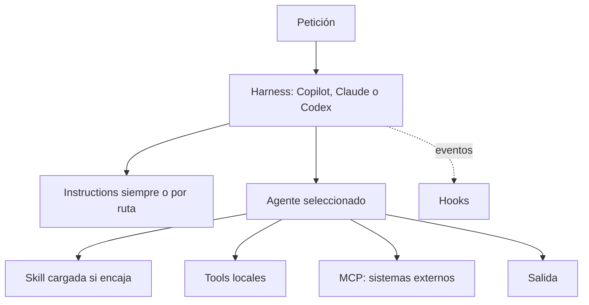

# Modelo mental completo

El **modelo** genera. El **harness** controla contexto, herramientas, permisos y ciclo. Por eso un mismo Markdown no se comporta idénticamente en Copilot, Claude Code y Codex.

## Decisión rápida
| Necesidad | Pieza |
|---|---|
| Java 11 siempre | Instruction |
| Revisor de seguridad | Agent |
| Ejecutar Maven y resumir Surefire | Skill |
| Lanzar “crear feature” con variables | Prompt file |
| Bloquear `rm -rf` | Hook |
| Consultar SonarQube/Jira | MCP |
| Coordinar fases | Agent + subagents/handoffs |
