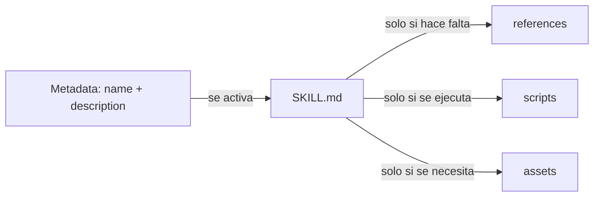

# Skills: procedimientos reutilizables bajo demanda

Una skill empaqueta instrucciones para una tarea recurrente y, opcionalmente, scripts, referencias y recursos. El harness descubre su metadata y decide cuándo cargarla; no es un agente, una instrucción global ni un servidor MCP.

## Cuándo usarla

| Necesidad | Usa |
|---|---|
| Regla estable que se aplica a muchos cambios | Instructions |
| Rol con autoridad, herramientas y salida propias | Agente |
| Procedimiento con pasos, ejemplos, referencias o scripts | Skill |
| Entrada parametrizada para iniciar una tarea | Prompt file |
| Control ejecutable antes o después de una acción | Hook |
| Integración con un servicio o datos externos | MCP |

Busca primero una skill existente y comprueba su licencia, origen, compatibilidad del harness y contenido antes de instalarla o copiarla.

## Ubicaciones

Las rutas no son universales. Ejemplos documentados para harnesses compatibles con VS Code:

| Harness | Skill del repositorio | Skill personal |
|---|---|---|
| GitHub Copilot | `.github/skills/<name>/SKILL.md` | `~/.copilot/skills/<name>/SKILL.md` |
| VS Code Local | `.github/skills/`, `.claude/skills/` o `.agents/skills/` | `~/.copilot/skills/` |
| Claude Code | `.claude/skills/<name>/SKILL.md` | `~/.claude/skills/<name>/SKILL.md` |
| OpenAI Codex | `.agents/skills/<name>/SKILL.md` | `~/.agents/skills/<name>/SKILL.md` |

La integración experimental de Codex en VS Code puede descubrir `.github/skills/`; no presupongas que Codex nativo lo hará. Confirma la ruta en el harness y versión que realmente usará el equipo. Evita duplicar una skill con el mismo nombre en varias ubicaciones sin necesidad.

## Estructura recomendada

```text
.github/skills/maven-test-summary/
├── SKILL.md                         # requerido
├── scripts/
│   └── run-tests.sh                 # opcional: acciones acotadas y repetibles
├── references/
│   └── surefire-guide.md            # opcional: detalle bajo demanda
└── assets/
    └── report-template.md           # opcional: plantillas y datos estáticos
```

`SKILL.md` debe explicar el procedimiento principal; no conviertas la skill en un depósito de documentación que siempre se carga. Divide el detalle y enlaza recursos con rutas relativas, preferentemente a un nivel de profundidad.

## Frontmatter completo del estándar Agent Skills

Este es el esquema del estándar abierto; cada harness puede admitir solo una parte.

| Campo | Requerido | Reglas |
|---|---:|---|
| `name` | Sí | 1–64 caracteres; minúsculas `a-z`, números y guiones; sin guiones al inicio/final ni `--`; debe coincidir con el nombre de la carpeta. |
| `description` | Sí | 1–1024 caracteres; describe qué hace y cuándo activarla; usa palabras concretas que el agente pueda reconocer en una petición. |
| `license` | No | Nombre de licencia o referencia a un archivo de licencia incluido. |
| `compatibility` | No | 1–500 caracteres; solo si hay requisitos concretos de producto, sistema, paquetes o red. |
| `metadata` | No | Mapa de claves y valores de texto para datos adicionales; elige claves específicas para evitar colisiones. |
| `allowed-tools` | No | Lista separada por espacios de herramientas preaprobadas. Campo experimental: el soporte varía y no sustituye los permisos del harness. |

Ejemplo válido:

```yaml
---
name: maven-test-summary
description: Ejecuta tests Maven dirigidos y resume fallos de Surefire. Úsala al validar cambios Java o investigar tests fallidos.
license: MIT
compatibility: Requiere Java, Maven Wrapper recomendado y acceso al repositorio local de dependencias.
metadata:
  author: equipo-plataforma
  version: "1.0"
---
```

No añadas campos inventados al frontmatter. `argument-hint`, `tools`, `model`, `handoffs` y `applyTo` no forman parte del frontmatter estándar de skills; pertenecen a otros mecanismos o a extensiones concretas del harness.

## Qué incluir siempre en el cuerpo

Usa solo las secciones que aporten a la tarea, pero deja explícito el contrato:

1. **Propósito y límites:** resultado buscado y qué queda fuera.
2. **Activación:** el `description` debe incluir cuándo usarla y sinónimos útiles.
3. **Entrada necesaria:** archivos, módulo, versión, criterios o datos de partida.
4. **Precondiciones:** herramientas, dependencias, permisos, estado limpio u otras condiciones verificables.
5. **Procedimiento:** pasos numerados, concretos y ordenados; incluye decisiones y ramas.
6. **Errores y casos límite:** qué hacer si falta un archivo, falla un comando o los resultados son ambiguos.
7. **Verificación:** comandos reales, criterios objetivos y cómo conservar el código de salida.
8. **Salida:** forma de informar resultados, pruebas no ejecutadas, riesgos y siguientes pasos.
9. **Seguridad:** datos que no deben exponerse, acciones que requieren aprobación y prohibiciones.
10. **Referencias:** documentos/scripts que se abren solo cuando hacen falta.

No ordenes “tener cuidado” de forma abstracta: especifica qué inspeccionar, qué no hacer y qué condición detiene el flujo.

## Ejemplo completo

```markdown
---
name: maven-test-summary
description: Ejecuta tests Maven dirigidos y resume fallos de Surefire. Úsala al validar cambios Java o investigar tests fallidos.
---

# Objetivo
Validar un test o módulo Maven y resumir el resultado sin ocultar fallos.

# Entrada
- Módulo, clase o test objetivo.
- Si no se indica un test, pregunta cuál ejecutar antes de lanzar una suite amplia.

# Procedimiento
1. Localiza `mvnw` y el `pom.xml` del módulo antes de ejecutar.
2. Ejecuta primero el test más acotado que cubra el cambio.
3. Conserva y comunica el código de salida del proceso.
4. Si existe `target/surefire-reports`, lee los informes relacionados con esa ejecución.
5. Resume errores y el primer marco de código del proyecto que ayude a localizar la causa.

# Límites
- No uses `-DskipTests`.
- No borres cachés ni repositorios Maven.
- No afirmes que una prueba pasó si no se ejecutó y comprobó su código de salida.
- No incluyas secretos ni datos personales en el informe.

# Salida
Comando y módulo, código de salida, tests pasados/fallidos/omitidos, causa probable con evidencia, limitaciones y siguiente paso.
```

## Diseño progresivo y tamaño



- Mantén `SKILL.md` por debajo de 500 líneas y, como recomendación, el cuerpo de instrucciones por debajo de 5.000 tokens.
- Carga referencias solo cuando sean pertinentes; cada archivo debe resolver una necesidad concreta.
- Los scripts deben documentar dependencias, validar argumentos, emitir errores útiles y devolver códigos de salida correctos.
- No guardes credenciales en una skill, scripts, ejemplos ni logs. Usa el mecanismo seguro de secretos del entorno.
- El agente puede ignorar instrucciones: los permisos, aprobaciones, tests y controles CI deben proteger las acciones importantes.

## Crear, validar y probar

1. Define un resultado repetible que no sea una regla global ni un rol completo.
2. Elige la ruta compatible con el harness objetivo.
3. Escribe `name` y `description`; comprueba que nombre y carpeta coinciden.
4. Añade únicamente los recursos realmente necesarios.
5. Valida el frontmatter y la estructura:

   ```bash
   skills-ref validate .github/skills/maven-test-summary
   ```

6. En el harness real, prueba una petición que debe activarla y otra parecida que no debe activarla.
7. Revisa si eligió la skill correcta, siguió los pasos, ejecutó solo herramientas permitidas y reportó con honestidad.
8. Actualiza ejemplos y referencias cuando cambien comandos, versiones o el contrato de salida.

La validación de `skills-ref` comprueba formato; no demuestra que un harness descubra, active o ejecute correctamente la skill.

## Fuentes

- [Agent Skills Specification](https://agentskills.io/specification)
- [Agent Skills en VS Code](https://code.visualstudio.com/docs/agent-customization/agent-skills)
- La compatibilidad y las ubicaciones pueden cambiar; consulta también [Harnesses](./08-harnesses.md).
