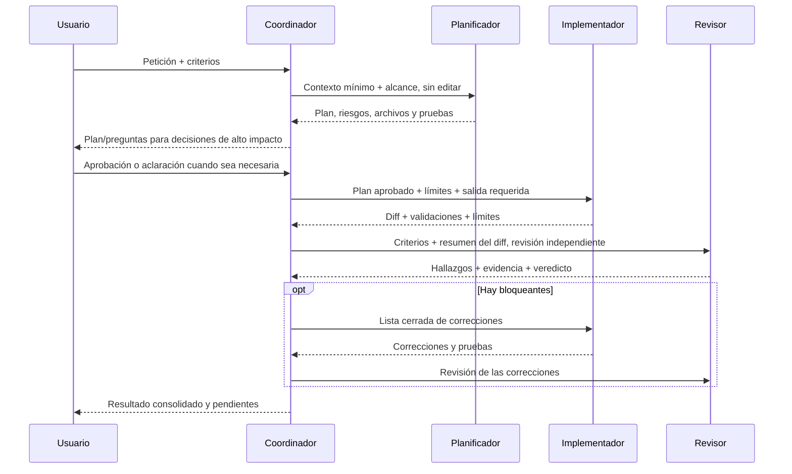

# Coordinación de agentes y subagentes

Un **coordinador** es un agente que controla la secuencia y consolida resultados. Un **subagente** es una ejecución delegada con una tarea y contexto acotados. Un **handoff** es una transición sugerida o presentada al usuario: no equivale por sí misma a delegación.

## Cuándo delegar

Delega cuando la tarea tiene fases diferenciadas, una perspectiva realmente independiente o trabajo de investigación paralelizable. Trabaja directamente en tareas simples. No delegues por rutina ni envíes dos workers a modificar los mismos archivos.

| Fase | Rol | Permisos recomendados | Entrega |
|---|---|---|---|
| Análisis | Planificador | Lectura y búsqueda | Alcance, archivos, decisiones, riesgos y pruebas; no edita. |
| Cambio | Implementador | Lectura, búsqueda y edición; ejecución de comandos solo si se permite explícitamente | Diff, desviaciones, pruebas ejecutadas/no ejecutadas y riesgos. |
| Verificación | Revisor | Lectura y búsqueda | Hallazgos priorizados, evidencia y veredicto; no edita. |
| Revisión especializada | Seguridad u otro especialista | Solo capacidades necesarias; lectura por defecto | Informe de evidencia y mitigaciones, sin implementar. |

## Flujo completo



No pidas aprobación para cada decisión mecánica. Detente antes de cambios de contrato, datos, alcance ambiguo, migraciones irreversibles, despliegue o efectos externos que requieran decisión humana.

## Contrato de delegación

Cada tarea enviada al subagente debe incluir:

```text
Objetivo: un resultado concreto.
Contexto: archivos/criterios relevantes y hechos verificados.
Alcance: qué debe tocar o inspeccionar.
Límites: qué no debe hacer; permisos y acciones prohibidas.
Salida: formato, evidencia y archivos/líneas requeridos.
Validación: tests/comandos permitidos y cómo reportar si no se ejecutan.
Parada: condición de finalización y qué hacer si falta información.
```

No asumas que el worker hereda el historial. En VS Code Local, los encargos deben ser autosuficientes y los resultados no garantizan que el subagente conserve una conversación para seguimiento.

## Reglas del coordinador

1. Clasifica impacto y decide si hace falta delegación.
2. Recoge solo contexto necesario; no pases secretos ni historial irrelevante.
3. Pide plan sin editar cuando haya varias fases o riesgo relevante.
4. Mantén autoridad separada: el coordinador organiza; el implementador cambia; el revisor observa.
5. Define nombres exactos de agentes permitidos y limita el acceso a ellos.
6. Paraleliza solo tareas independientes, por ejemplo investigación de módulos distintos.
7. No pidas auto-revisión al implementador como sustituto de revisión independiente.
8. Comprueba las salidas y tools de los workers; no informes como hecho una acción que no ocurrió.
9. Permite como máximo una ronda acotada de correcciones/revisión; si persisten bloqueantes, detente y explica.
10. Si el harness no soporta delegación, no finjas subagentes: usa los perfiles secuencialmente y conserva sus entregas como artefactos.

## Configuración en VS Code Local

El agente incluido en este repositorio es específico del harness **Local**:

```yaml
---
name: Coordinador
description: Coordina una tarea de software con planificación, implementación y revisión independiente.
target: vscode
tools: ['agent', 'read', 'search']
agents: ['Planificador Spring Angular', 'Implementador Legacy', 'Revisor Legacy', 'Revisor Seguridad']
---
```

- Selecciona el harness **Local**, comprueba que la herramienta `agent` está disponible y usa exactamente los nombres configurados.
- `agents` limita los workers disponibles en este harness; no es un campo universal.
- Los workers de este repositorio se ocultan del selector manual y tienen herramientas más limitadas.
- Habilita en el agente implementador solo el mecanismo de ejecución de tests que exista y esté aprobado en tu instalación. Los nombres de tools varían; no copies nombres de otro entorno.
- Si no existe ejecución autorizada, el worker debe declarar las pruebas como no ejecutadas. No amplíes a ciegas los permisos.
- La delegación anidada queda deshabilitada salvo que haya una necesidad concreta, presupuesto, límite de profundidad y condición de parada.

Configuración y flujo ejecutable: [`coordinator.agent.md`](../.github/agents/coordinator.agent.md). Las skills, instructions y permisos del harness se documentan por separado en [Skills](./04-skills.md), [Instructions](./03-instructions.md) y [Harnesses](./08-harnesses.md).

## Handoff manual o asistido

Si el harness no puede invocar workers:

1. Selecciona el perfil Planificador y guarda su plan.
2. Pide al usuario aprobar decisiones de alto impacto.
3. Selecciona Implementador y pásale el plan aprobado completo.
4. Guarda el resumen/diff y selecciónalo para Revisor en una conversación distinta.
5. Devuelve al Implementador solo los hallazgos bloqueantes concretos.
6. Consolida resultados, tests y limitaciones.

Una propiedad `handoffs` solo funciona donde el esquema del harness la admite. Comprueba los campos de handoff y prueba el recorrido en la versión objetivo.

## Cuándo parar

- No hay criterios suficientes para implementar con seguridad.
- El agente requerido no está disponible o no tiene permisos.
- Se necesita una acción irreversible o externa sin aprobación.
- Un test falla y la causa no está resuelta.
- Se agotó la ronda de corrección o dos workers discrepan sobre un hecho esencial.

## Fuentes

- [Subagentes en VS Code](https://code.visualstudio.com/docs/agents/run/subagents)
- [Referencia de archivos de agentes](https://code.visualstudio.com/docs/agents/reference/custom-agent-file-reference)
